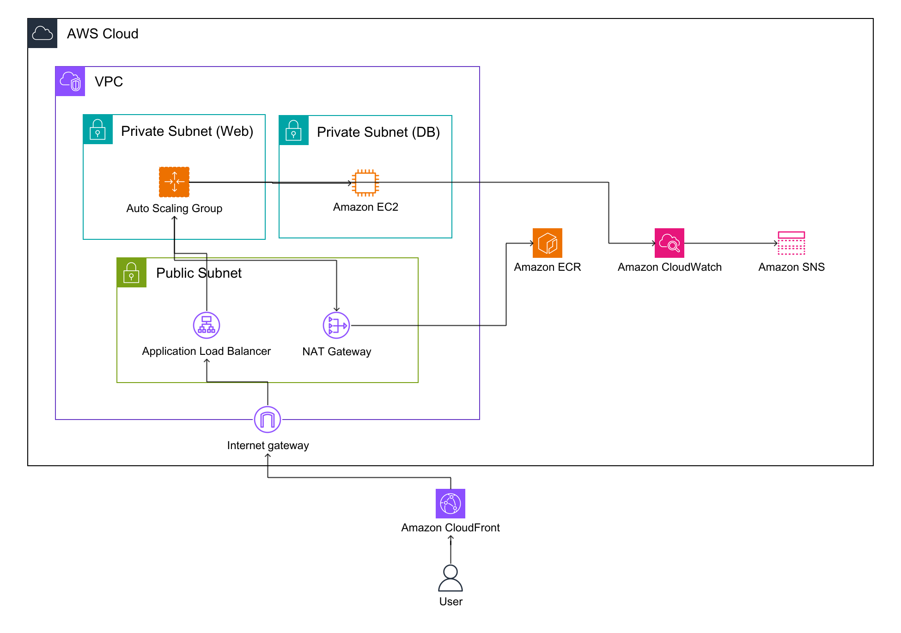
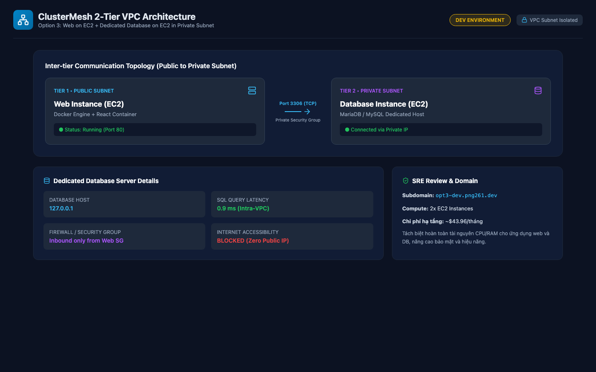
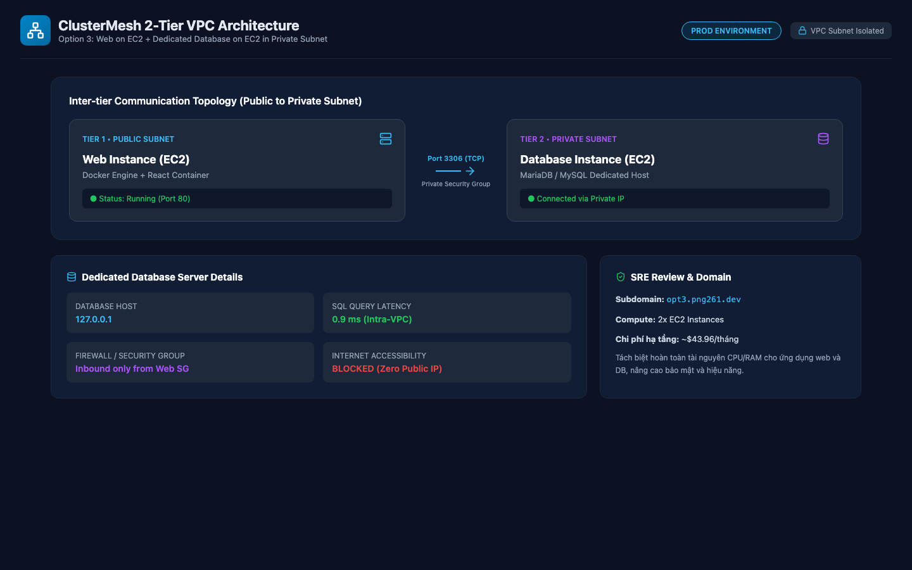

# Option 3: 1 EC2 Web ASG + 1 EC2 Dedicated DB Separated

Independent infrastructure and application source code for **Option 3: Multi-Tier Architecture with Auto Scaling Web EC2, Dedicated Database EC2, and AWS NAT Gateway**.

## 1. Architecture Overview

## 2. Cost Analysis

> **Verified via Infracost CLI:** Cost calculations derived directly from CloudFormation templates using `infracost scan ./infra/modules`.

### A. Component Cost Breakdown (Infracost CLI Verified)
| CloudFormation Module / Component | AWS Resource Type | Monthly Cost (USD) | Notes |
| :--- | :--- | :--- | :--- |
| **AWS NAT Gateway** | `AWS::EC2::NatGateway` | **$32.85** | Managed NAT Gateway in Public Subnet (0.0.0.0/0 egress) |
| **Application Load Balancer (ALB)** | `AWS::ElasticLoadBalancingV2::LoadBalancer` | **$16.43** | Multi-AZ load balancing and health checks |
| **Dedicated DB EC2 Server** | `AWS::EC2::Instance` (`t3.micro` + 30GB EBS) | **$10.49** | Isolated compute & persistent storage for PostgreSQL |
| **Web Compute (Auto Scaling Group)** | `AWS::AutoScaling::AutoScalingGroup` (`t3.micro`) | **$9.49** | Stateless web application compute tier |
| **Secrets & Operational Monitoring** | `SecretsManager`, `CloudWatch`, `SNS` | **$0.30** | Dual secrets (DB + App) and multi-tier alarms |
| **Total Monthly Cost** | `infra/modules/` | **$69.56 / mo** | ~1,760,000 VND / month |

*(Saves **$69.35 / month** compared to the previous 7 VPC Interface Endpoints architecture at $102.20/month).*

### B. Cost by Purchasing Option & Commitment
| Purchasing Model | Web Compute | DB Compute + EBS | NAT Gateway & ALB | Total Monthly Cost | Approx. Local Currency (VND) |
| :--- | :--- | :--- | :--- | :--- | :--- |
| **On-Demand (Default)** | $9.49 | $10.49 | $49.58 | **$69.56 / mo** | ~1,760,000 VND |
| **1-Year Savings Plan / RI** | $5.98 | $6.98 | $49.58 | **$62.54 / mo** *(10% savings)* | ~1,580,000 VND |
| **3-Year Savings Plan / RI** | $3.79 | $4.79 | $49.58 | **$58.16 / mo** *(16% savings)* | ~1,470,000 VND |
| **Hybrid (Web Spot + DB 1-Yr RI)** | $2.84 | $6.98 | $49.58 | **$59.40 / mo** *(15% savings)* | ~1,500,000 VND |

## 3. Disaster Recovery & Recovery Time (MTTR)

Tested and verified under real AWS Chaos Engineering scenarios:

| Failure Scenario | Recovery Mechanism | Measured Recovery Time (MTTR) | Fault Isolation / Impact |
| :--- | :--- | :--- | :--- |
| **PostgreSQL Service Outage on DB EC2** | Service restart + Driver auto-reconnect | **11 seconds** | Web tier completely isolated (0s downtime on Web) |
| **Web ↔ DB Network Partition (SG Severed)** | Security Group Ingress re-authorization | **3 seconds** | Fast connection pool recovery |
| **Web EC2 Instance Termination** | Web ASG auto-replacement in Private Subnets | **140 seconds** | DB server completely unaffected |
| **Target Response Latency** | CloudWatch ALB Metrics | **8.8ms average** | Independent tier compute isolation |

## 4. Application Screenshots

| Development Environment (`opt3-dev.png261.dev`) | Production Environment (`opt3.png261.dev`) |
| :---: | :---: |
|  |  |
